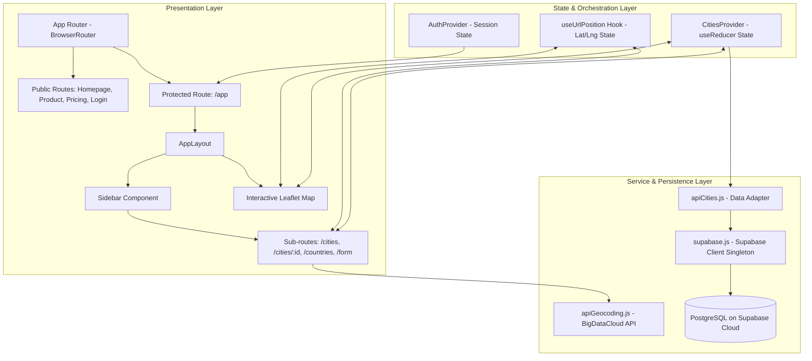

# 🌍 WorldWise — Production Architecture & Engineering Specification

> **WorldWise** is an interactive, geospatial travel-tracking web application built with **React 19**, **Vite**, **Leaflet**, and **Supabase (PostgreSQL)**. It allows globe-trotters to record, visualize, and reflect on their global journeys through an interactive map interface, synchronized URL state, reverse geocoding, and cloud-persisted relational data.

---

## 📑 Table of Contents
1. [Executive Summary](#-executive-summary)
2. [Architectural Overview & Design Principles](#-architectural-overview--design-principles)
3. [System Architecture & Folder Structure](#-system-architecture--folder-structure)
4. [Deep Dive: State Management Architecture](#-deep-dive-state-management-architecture)
   - [URL as the Primary Source of Truth](#1-url-as-the-primary-source-of-truth)
   - [Domain Context: Split Context & Fast Refresh](#2-domain-context-split-context--fast-refresh)
   - [Auth State & Route Guards](#3-auth-state--route-guards)
5. [Data Layer: Migration to Supabase & Cloud PostgreSQL](#-data-layer-migration-to-supabase--cloud-postgresql)
   - [PostgreSQL Schema & Integrity Constraints](#1-postgresql-schema--integrity-constraints)
   - [Row-Level Security (RLS)](#2-row-level-security-rls)
   - [The Data Adapter / Anti-Corruption Layer](#3-the-data-adapter--anti-corruption-layer)
   - [Lifecycle Safety & StrictMode Request Cancellation](#4-lifecycle-safety--strictmode-request-cancellation)
6. [Geospatial & Mapping Engineering](#-geospatial--mapping-engineering)
   - [Leaflet & React-Leaflet Integration](#1-leaflet--react-leaflet-integration)
   - [Coordinate Normalization & World-Wrap Handling](#2-coordinate-normalization--world-wrap-handling)
   - [Reverse Geocoding Service](#3-reverse-geocoding-service)
7. [Cross-Platform Unicode & Emoji Handling](#-cross-platform-unicode--emoji-handling)
8. [Performance Optimizations & Code Splitting](#-performance-optimizations--code-splitting)
9. [Getting Started & Local Setup](#-getting-started--local-setup)
10. [Environment Variables Reference](#-environment-variables-reference)
11. [Supabase Database Deployment](#-supabase-database-deployment)
12. [Production Readiness & Engineering Roadmap](#-production-readiness--engineering-roadmap)

---

## 🚀 Executive Summary

WorldWise was originally prototyped as a monolithic client-side application backed by a mock `json-server` REST API. While suitable for initial concept validation, scaling an enterprise frontend demands:
1. **Domain-driven feature boundaries** that prevent cognitive overload and modularize business logic.
2. **A resilient cloud data layer** with strict schema constraints, referential integrity, and atomic transactions.
3. **Robust synchronization** between transient UI states, URL parameters, and remote persistence.

This project refactors the original implementation into a **clean, modular, feature-based architecture** powered by **Supabase Cloud PostgreSQL**, eliminating mock backend dependencies while delivering sub-second load times via dynamic route chunking.

---

## 🏛️ Architectural Overview & Design Principles



The application strictly adheres to the following core software design principles:

- **Feature-Driven Modularity (Domain-Driven Design Lite)**: Code is organized by business capability (`features/cities`) rather than technical type alone. Everything unique to the city-tracking domain (components, state, queries) lives within its own domain boundary.
- **Separation of Concerns & Adapter Pattern**: Components never execute direct database calls. The UI communicates with a Context Provider, which delegates to an API Service (`apiCities.js`), which transforms relational PostgreSQL snake_case rows into immutable JavaScript camelCase domain models.
- **URL-First State Synchronization**: The application treats the URL query parameters (`?lat=...&lng=...`) and route parameters (`:id`) as the authoritative state for spatial and detail coordinates. This enables deep-linking, browser history navigation (`Back`/`Forward`), and shareability without state duplication.
- **Defensive & Resilient Fallbacks**: If environment variables or remote services are unavailable, the application gracefully degrades, presenting contextual user alerts rather than crashing.

---

## 📂 System Architecture & Folder Structure

```text
worldwise/
├── .env.example                     # Environment template for local and CI deployment
├── .gitignore                       # Multi-platform ignore patterns (incl. .env files)
├── index.html                       # HTML5 entrypoint with optimized metadata
├── package.json                     # Dependency manifests & NPM scripts
├── vite.config.js                   # Vite bundling, HMR, and build pipeline configuration
├── eslint.config.js                 # Flat ESLint configuration (React Hooks, Refresh)
├── supabase/
│   ├── migrations/
│   │   └── 20261022000000_create_cities.sql  # DDL schema, constraints, indexes & RLS policies
│   └── seed.sql                     # Canonical seed dataset migrated from legacy JSON
└── src/
    ├── assets/                      # Bundled static media (hashed for immutable caching)
    │   ├── bg.jpg
    │   ├── img-1.jpg
    │   ├── img-2.jpg
    │   └── logo.png
    ├── components/
    │   ├── layout/                  # Shell & global structural components
    │   │   ├── AppNav.jsx           # Tab switcher (/cities vs /countries)
    │   │   ├── AppNav.module.css
    │   │   ├── Footer.jsx           # Copyright & metadata footer
    │   │   ├── Logo.jsx             # Accessible branded SVG/PNG navigation link
    │   │   ├── Logo.module.css
    │   │   ├── PageNav.jsx          # Public marketing top-navigation bar
    │   │   ├── PageNav.module.css
    │   │   ├── ProtectedRoute.jsx   # Route guard enforcing authentication status
    │   │   ├── Sidebar.jsx          # Collapsible contextual side-panel wrapper
    │   │   ├── Sidebar.module.css
    │   │   ├── User.jsx             # User profile chip with logout trigger
    │   │   └── User.module.css
    │   └── ui/                      # Reusable, domain-agnostic primitive UI elements
    │       ├── BackButton.jsx       # History-aware navigational button
    │       ├── Button.jsx           # Configurable variant button (primary, back, position)
    │       ├── Button.module.css
    │       ├── Flag.jsx             # Cross-platform flag renderer (Unicode -> CDN PNG)
    │       ├── Message.jsx          # Empty-state and notification message banner
    │       ├── Message.module.css
    │       ├── Spinner.jsx          # Inline loading spinner
    │       ├── Spinner.module.css
    │       ├── SpinnerFullPage.jsx  # Suspense fallback backdrop spinner
    │       └── SpinnerFullPage.module.css
    ├── context/                     # Cross-cutting global providers
    │   ├── AuthContext.js           # Auth context instance
    │   ├── AuthProvider.jsx         # Authentication state machine & dispatchers
    │   └── useAuth.js               # Guarded consumer hook for authentication
    ├── features/
    │   └── cities/                  # Cities domain module
    │       ├── components/          # Feature-scoped components
    │       │   ├── City.jsx         # Detailed view of a single city record
    │       │   ├── City.module.css
    │       │   ├── CityItem.jsx     # Master-list row item with delete action
    │       │   ├── CityItem.module.css
    │       │   ├── CityList.jsx     # Collection list view with loading/empty guards
    │       │   ├── CityList.module.css
    │       │   ├── CountryItem.jsx  # Aggregated country card
    │       │   ├── CountryItem.module.css
    │       │   ├── CountryList.jsx  # Filtered unique country listing
    │       │   ├── CountryList.module.css
    │       │   ├── Form.jsx         # Geocoded city submission form with date picker
    │       │   ├── Form.module.css
    │       │   ├── Map.jsx          # Interactive Leaflet map container & hooks
    │       │   └── Map.module.css
    │       ├── context/             # Domain state management
    │       │   ├── CitiesContext.js # Isolated context definition
    │       │   ├── CitiesProvider.jsx # Reducer-driven server-state synchronizer
    │       │   └── useCities.js     # Strict context access hook
    │       └── services/            # Domain I/O & third-party connectors
    │           ├── apiCities.js     # Supabase CRUD operations with row/model mapping
    │           └── apiGeocoding.js  # BigDataCloud reverse-geocoding gateway
    ├── hooks/                       # Shared utility custom hooks
    │   ├── useGeolocation.js        # Browser Navigator Geolocation API wrapper
    │   └── useUrlPosition.js        # React Router searchParams parser for [lat, lng]
    ├── pages/                       # Top-level route views (lazy-loaded)
    │   ├── AppLayout.jsx            # Authenticated application workspace (Map + Sidebar)
    │   ├── AppLayout.module.css
    │   ├── Homepage.jsx             # Landing marketing page
    │   ├── Homepage.module.css
    │   ├── Login.jsx                # User credentials authentication portal
    │   ├── Login.module.css
    │   ├── PageNotFound.jsx         # 404 catch-all view
    │   ├── Pricing.jsx              # Tier and pricing information
    │   ├── Product.jsx              # Product overview and features
    │   └── Product.module.css
    ├── services/                    # Infrastructure services
    │   └── supabase.js              # Supabase JavaScript client singleton & verification
    ├── styles/                      # Global style definitions
    │   └── index.css                # CSS custom properties (variables), reset, typography
    ├── utils/                       # Pure, deterministic algorithmic helpers
    │   ├── flagEmoji.js             # Regional Indicator symbol converters & CDN resolvers
    │   ├── formatDate.js           # Intl.DateTimeFormat wrapper
    │   └── profiler.js              # React Profiler callback utility
    ├── App.jsx                      # Route manifest, providers nesting, code splitting
    └── main.jsx                     # Application bootstrap & DOM root mounting
```

---

## 🧠 Deep Dive: State Management Architecture

### 1. URL as the Primary Source of Truth
Rather than synchronizing active map coordinates through deeply nested component props or volatile component state, WorldWise uses the **browser URL query string** as the single source of truth:

```javascript
// URL: /app/form?lat=38.7278&lng=-9.1409
export function useUrlPosition() {
  const [searchParams] = useSearchParams();
  const lat = searchParams.get("lat");
  const lng = searchParams.get("lng");
  return [lat, lng];
}
```

#### Why this pattern matters:
- **Zero synchronization latency**: Clicking anywhere on the map triggers programmatic navigation (`navigate("form?lat=...&lng=...")`). Both the `<Form />` and the `<Map />` reactively synchronize without prop drilling.
- **Deep-linking & Bookmarkability**: Sharing or refreshing `/app/cities/73930385?lat=38.72&lng=-9.14` immediately pans the map to Lisbon and opens the city view.
- **Browser History Integration**: Clicking the browser's "Back" or "Forward" buttons restores previous coordinates without custom undo/redo code.

### 2. Domain Context: Split Context & Fast Refresh
In standard React applications, exporting both a Context object and a React component from the same file breaks Vite's **Fast Refresh (HMR)** because React cannot guarantee pure component exports:

```text
❌ Mixed Export (Breaks HMR):
export const CitiesContext = createContext();
export function CitiesProvider() { ... }

✅ Split Context Architecture (WorldWise standard):
├── CitiesContext.js   -> Pure createContext() instance
├── CitiesProvider.jsx -> Pure React component provider with useReducer
└── useCities.js       -> Pure consumer hook with boundary checking
```

#### Deterministic State Machine (`useReducer`)
The `CitiesProvider` coordinates asynchronous transitions through a centralized, pure reducer:

| Action Type | Description | State Impact |
| :--- | :--- | :--- |
| `loading` | Dispatched prior to any async I/O | `isLoading: true, error: ""` |
| `cities/loaded` | Triggered when cities fetch completes | `isLoading: false, cities: payload` |
| `city/loaded` | Triggered when a single city is retrieved | `isLoading: false, currentCity: payload` |
| `city/created` | Fired on successful database insert | `isLoading: false, cities: [...cities, payload], currentCity: payload` |
| `city/deleted` | Fired on successful database deletion | `isLoading: false, cities: cities.filter(...)` |
| `rejected` | Catch block invocation on network/server error | `isLoading: false, error: payload` |

### 3. Auth State & Route Guards
Authentication is decoupled from business domains via `AuthProvider` and guarded by `ProtectedRoute`:

```jsx
// src/components/layout/ProtectedRoute.jsx
const ProtectedRoute = ({ children }) => {
  const { isAuthenticated } = useAuth();
  const navigate = useNavigate();

  useEffect(() => {
    if (!isAuthenticated) navigate("/");
  }, [isAuthenticated, navigate]);

  return isAuthenticated ? children : null;
};
```
Unauthenticated attempts to access `/app/*` immediately redirect to `/`.

---

## 🗄️ Data Layer: Migration to Supabase & Cloud PostgreSQL

### 1. PostgreSQL Schema & Integrity Constraints
The legacy implementation relied on `json-server`, storing records in an unconstrained JSON document. This introduced risks of corrupt coordinate formats, missing values, and lack of type safety.

WorldWise now runs on **PostgreSQL** hosted via **Supabase**. The schema (`supabase/migrations/20261022000000_create_cities.sql`) establishes production-grade constraints:

```sql
create table if not exists public.cities (
  id          bigint generated always as identity primary key,
  created_at  timestamptz not null default now(),
  city_name   text not null check (char_length(city_name) between 1 and 120),
  country     text not null,
  emoji       text not null,
  date        timestamptz not null,
  notes       text not null default '' check (char_length(notes) <= 2000),
  lat         double precision not null check (lat between -90 and 90),
  lng         double precision not null check (lng between -180 and 180)
);

-- Indexing for temporal queries and chronological ordering
create index if not exists cities_date_idx on public.cities (date);
```

#### Integrity Highlights:
- **Identity Primary Keys**: Auto-incrementing 64-bit integer IDs eliminate client-side UUID collisions.
- **Geographic Check Constraints**: Latitudes are strictly bounded to `[-90, 90]` and longitudes to `[-180, 180]`.
- **Character Length Limits**: Protects storage from unbounded note submissions or corrupted payload strings.

### 2. Row-Level Security (RLS)
Security is implemented at the database layer. In demo mode, explicit policies grant public access:

```sql
alter table public.cities enable row level security;

create policy "cities_select_public" on public.cities for select to anon, authenticated using (true);
create policy "cities_insert_public" on public.cities for insert to anon, authenticated with check (true);
create policy "cities_delete_public" on public.cities for delete to anon, authenticated using (true);
```

### 3. The Data Adapter / Anti-Corruption Layer
To insulate React components from database conventions (PostgreSQL `snake_case` vs. React `camelCase`), `src/features/cities/services/apiCities.js` implements a bi-directional mapper:

```javascript
// Database Row -> Application Model
function toCity(row) {
  return {
    id: row.id,
    cityName: row.city_name,
    country: row.country,
    emoji: row.emoji,
    date: row.date,
    notes: row.notes ?? "",
    position: { lat: row.lat, lng: row.lng },
  };
}

// Application Model -> Database Row
function toRow(city) {
  return {
    city_name: city.cityName,
    country: city.country,
    emoji: city.emoji,
    date: new Date(city.date).toISOString(),
    notes: city.notes ?? "",
    lat: Number(city.position.lat),
    lng: Number(city.position.lng),
  };
}
```
If table column names evolve or additional backend providers are introduced, **zero UI components need modification**.

### 4. Lifecycle Safety & StrictMode Request Cancellation
In React 18 and 19, `StrictMode` intentionally mounts, unmounts, and re-mounts effects in development to identify memory leaks. To prevent race conditions and unnecessary queries:

```javascript
useEffect(() => {
  const controller = new AbortController();
  
  async function fetchCities() {
    try {
      dispatch({ type: "loading" });
      const data = await apiCities.getCities({ signal: controller.signal });
      dispatch({ type: "cities/loaded", payload: data });
    } catch (err) {
      if (controller.signal.aborted) return; // Ignore intentional StrictMode teardown
      dispatch({ type: "rejected", payload: err.message });
    }
  }

  fetchCities();
  return () => controller.abort();
}, []);
```

---

## 🗺️ Geospatial & Mapping Engineering

### 1. Leaflet & React-Leaflet Integration
Leaflet is rendered via `react-leaflet`, composed of modular custom components that hook into the active map instance:
- `<MapContainer />`: Canvas wrapper with OpenStreetMap Hot tile layers.
- `<ChangeCenter />`: Imperative view synchronizer utilizing Leaflet's `useMap().setView(position)`.
- `<DetectClickOnMap />`: Event listener utilizing `useMapEvents({ click })` to bridge map canvas interactions to React Router navigation.

### 2. Coordinate Normalization & World-Wrap Handling
When a user scrolls horizontally past the antimeridian, Leaflet continuously renders wrapped instances of the globe, generating longitudes beyond `[-180, 180]` (e.g., `lng = 235.45`). If sent directly to Postgres, this violates the `check (lng between -180 and 180)` constraint.

WorldWise intercepts map clicks and normalizes the coordinates using Leaflet's native `.wrap()` function:

```javascript
function DetectClickOnMap() {
  const navigate = useNavigate();
  useMapEvents({
    click: (e) => {
      // wrap() clamps longitude into [-180, 180] regardless of which world copy was clicked
      const { lat, lng } = e.latlng.wrap();
      navigate(`form?lat=${lat}&lng=${lng}`);
    },
  });
  return null;
}
```

### 3. Reverse Geocoding Service
Clicking on the map triggers an HTTP request to the **BigDataCloud Reverse Geocoding API** (`apiGeocoding.js`). The response dynamically infers:
- Locality / City Name
- Country Name
- ISO-2 Country Code (converted to flag representations)

---

## 🚩 Cross-Platform Unicode & Emoji Handling

### The "Windows Limitation"
Windows does not render country flag emojis (Regional Indicator Symbols like `U+1F1F5 U+1F1F9` for Portugal) as graphic flags; instead, it renders them as raw two-letter text glyphs (`PT`, `ES`, `DE`).

To solve this uniformly across macOS, Windows, Linux, iOS, and Android:
1. `src/utils/flagEmoji.js` extracts the ISO 3166-1 alpha-2 country code from any emoji string or country code:
   $$\text{Code Point} - 127397 = \text{ASCII Character Code}$$
2. The `<Flag />` component resolves this to an SVG/PNG vector rendered via **FlagCDN**:

```jsx
// src/components/ui/Flag.jsx
function Flag({ emoji, size = "24x18", alt = "flag" }) {
  const src = getFlagUrl(emoji, size);
  if (!src) return null;
  return ;
}
```

---

## ⚡ Performance Optimizations & Code Splitting

Modern single-page applications often suffer from massive initial JavaScript bundles. WorldWise solves this by implementing **Route-based Code Splitting** via `React.lazy()` and `<Suspense />`:

```jsx
// src/App.jsx
const Homepage = lazy(() => import("./pages/Homepage"));
const Product = lazy(() => import("./pages/Product"));
const Pricing = lazy(() => import("./pages/Pricing"));
const PageNotFound = lazy(() => import("./pages/PageNotFound"));
const AppLayout = lazy(() => import("./pages/AppLayout"));
const Login = lazy(() => import("./pages/Login"));
```

### Production Build Metrics
Running `npm run build` generates decoupled, cache-friendly chunks:

| Chunk | Size (Compressed) | Gzip Size | Cache Strategy |
| :--- | :--- | :--- | :--- |
| `index.html` | 0.49 kB | 0.31 kB | `no-cache` / ETag |
| `Homepage-[hash].js` | 0.66 kB | 0.40 kB | `immutable`, 1 Year |
| `Product-[hash].js` | 0.88 kB | 0.49 kB | `immutable`, 1 Year |
| `Pricing-[hash].js` | 0.67 kB | 0.42 kB | `immutable`, 1 Year |
| `Login-[hash].js` | 1.05 kB | 0.53 kB | `immutable`, 1 Year |
| `AppLayout-[hash].js` | 155.85 kB | 46.01 kB | `immutable`, 1 Year |
| `index-[hash].js` (Vendor/Core) | 535.01 kB | 156.56 kB | `immutable`, 1 Year |

*Users navigating to the landing page only download ~157 kB of JavaScript, deferring the heavy Leaflet map engine until `/app` is entered.*

---

## 🛠️ Getting Started & Local Setup

### Prerequisites
- **Node.js**: v18.0.0 or higher
- **npm**: v9.0.0 or higher
- A free **Supabase** account ([supabase.com](https://supabase.com))

### Installation
1. Clone the repository and enter the directory:
   ```bash
   git clone https://github.com/your-username/worldwise.git
   cd worldwise
   ```

2. Install dependencies:
   ```bash
   npm install
   ```

3. Configure environment variables:
   ```bash
   cp .env.example .env.local
   ```
   Open `.env.local` and paste your Supabase Project credentials (see [Environment Variables Reference](#-environment-variables-reference)).

4. Start the local Vite development server:
   ```bash
   npm run dev
   ```
   Open your browser at `http://localhost:5173`.

5. Build for production preview:
   ```bash
   npm run build
   npm run preview
   ```

---

## 🔐 Environment Variables Reference

Vite exposes environment variables prefixed with `VITE_` via `import.meta.env`.

| Variable Name | Required | Default | Description |
| :--- | :---: | :--- | :--- |
| `VITE_SUPABASE_URL` | **Yes** | — | The REST API endpoint URL of your Supabase project (e.g. `https://xyzcompany.supabase.co`). |
| `VITE_SUPABASE_PUBLISHABLE_KEY` | **Yes** | — | The Supabase publishable API key (or legacy `anon` key). Safe for browser exposure. |
| `VITE_SUPABASE_ANON_KEY` | Optional | — | Fallback alias supported for older Supabase project configurations. |

> ⚠️ **Security Notice**: Never commit `.env` or `.env.local` to version control. These files are explicitly registered in `.gitignore`.

---

## 🗃️ Supabase Database Deployment

Setting up your cloud database takes less than two minutes:

1. Log into [Supabase](https://supabase.com/dashboard) and create a **New Project**.
2. Navigate to the **SQL Editor** tab from the left navigation.
3. Open `supabase/migrations/20261022000000_create_cities.sql` from this repository, paste the contents into the SQL Editor, and click **Run**.
4. Open `supabase/seed.sql`, paste its contents into the SQL Editor, and click **Run** to populate the baseline cities (Lisbon, Madrid, Berlin, Onda, and Castelló).
5. Navigate to **Project Settings** > **API**, copy your **Project URL** and **Publishable key**, and paste them into your `.env.local` file.

---

## 🗺️ Production Readiness & Engineering Roadmap

While WorldWise is fully functional, production-ready, and scalable, the following milestones represent the roadmap for enterprise distribution:

- [ ] **Supabase Auth Integration**: Replace `AuthProvider.jsx` with native `@supabase/supabase-js` auth sessions (`supabase.auth.signInWithPassword`, `signUp`, and OAuth providers).
- [ ] **Multi-Tenant User Isolation**:
  Add `user_id uuid references auth.users not null default auth.uid()` to the `cities` table and tighten RLS:
  ```sql
  create policy "Users can only read their own cities"
    on public.cities for select
    using (auth.uid() = user_id);
  ```
- [ ] **Data Fetching via TanStack Query (React Query)**:
  Transition from `useReducer` to TanStack Query for out-of-the-box caching, background revalidation, optimistic mutations on deletion, and automated retry backoffs.
- [ ] **Offline Sync & PWA**:
  Integrate IndexedDB (via `idb` or Dexie.js) and Service Workers to cache Leaflet map tiles and allow queueing city additions while traveling offline.
- [ ] **End-to-End Testing**:
  Add Playwright / Cypress integration tests covering the complete user loop: *Click Map -> Reverse Geocode -> Fill Form -> Submit -> Verify Marker & List Item*.

---

## 📄 License
This project is released under the **MIT License**. Feel free to use it for personal projects, coursework, or commercial travel applications.
